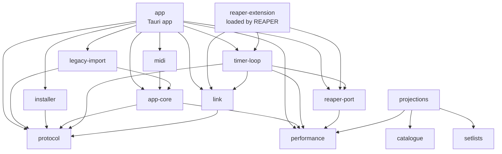

# Crates

One crate per area. The allowed dependencies are enforced by `architecture-tests`
(`dependency_rules.rs`); the folder shape by `layout_rules.rs`. When you add a crate, add it
here too (a test checks that).

## What each crate does

| Crate | Does | May use |
| --- | --- | --- |
| `shared-kernel` | The few value types every crate agrees on (`Seconds`, `Bpm`, ids). Deliberately tiny. | nothing |
| `performance` | The state machine that plays a setlist: hand-overs, hard stops, count-in. Pure: no I/O, no clock. | `shared-kernel` |
| `catalogue` | Songs, cues and directives as found in the REAPER project. Pure. | `shared-kernel` |
| `setlists` | Creating, editing and validating setlists. Pure. | `shared-kernel` |
| `projections` | Read models the UI renders, built from the state of the crates above. | `shared-kernel`, `performance`, `catalogue`, `setlists` |
| `protocol` | The wire protocol between the extension and the app, and the types the UI gets (also generated to TypeScript). | `shared-kernel` |
| `link` | The loopback connection (server in the extension, client in the app): framing, handshake, event log. | `shared-kernel`, `protocol` |
| `reaper-port` | The `ReaperPort` trait, the fake REAPER and the scenario runner. Everything REAPER-specific hides behind this trait. | `shared-kernel`, `performance` |
| `timer-loop` | One step of REAPER's timer, generic over the port: runs a performance, publishes state, takes commands. | the domain crates, `protocol`, `link`, `reaper-port` |
| `reaper-extension` | The native extension REAPER loads: plugin entry, panic guard, safe mode, journal, the bridge to `link`. | the domain crates, `protocol`, `link`, `reaper-port`, `timer-loop` |
| `app-core` | What the app shares: commands and their bus, app events, configuration, intents, the clock, and fakes for them. No Tauri, no devices. | `performance`, `protocol` |
| `midi` | MIDI input: device list and hot-plug, listener, debounce, router to intents. | `app-core` |
| `legacy-import` | Importing what v1 left behind: its config, setlists and journal. | `app-core`, `protocol` |
| `installer` | Installing the extension: plan, items, wizard checks, bundled extension location, process check. | `protocol` |
| `app` | The Tauri app: composition root (`shell.rs`), the link to the extension, health, setlist mirror, diagnostics, simulator. | everything above except `reaper-extension` |
| `architecture-tests` | Tests only: dependency rules, layout rules, version agreement, `testing/` shape. | - |

## How they depend on each other

An arrow means "may use". Everything also uses `shared-kernel` (left out of the picture).
Read it from the top: the app and the extension are the two programs; everything below is shared.

## Folder structure

Every crate keeps the same shape (`layout_rules.rs`): one type per file, `x.rs` next to a folder
`x/` for a type with helpers, singular `lower_snake_case` names, no `mod.rs`.

- `app-core/src`: `command/` (bus, queue, checks, driver), `event/`, `config/`, `intent/`, `clock/`, `link/` (cause, health), `fake/`.
- `app/src`: `link/` (session, pipeline, chaos proxy), `health/`, `mirror/`, `system/` (logging, diagnostics, stats, shutdown), `start/`, `simulator/`, `fake/`, `shell.rs`.
- `protocol/src`: `installation/`, `configuration/`, `link/`, `state/`, `song/`, `setlist/`, plus `frame/` and `message/` (the wire format) and `command.rs`.
- `performance/src`: the state machine files at the top; `tempo/` and `song/` beside them.
- `link/src`: `server/`, `client/`, `wire/`, `endpoint/`, `event_log/`.
- `reaper-extension/src`: `foreign_interface/` (the one unsafe FFI module), `fault/`, `fault_file/`, `safe_mode_marker/`, `tick_watchdog/`, `link_bridge/`, `journal.rs`, `start_up.rs`.
- `installer/src`: `extension/`, `reaper/`, `wizard/`, `item/`, `process/`, plus the plan, report and status types.
- `legacy-import/src`: `config/` (the v1 config file and its import), the v1 setlist, item and MIDI readers, the resolver and the journal import.
- `midi/src`: the listener, router, debounce, device follower and switch; `midir/` is the real-device backend.
